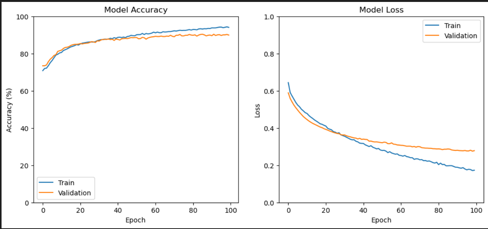

##  Deepfake Detection of Spatio-Temporal Data with Explainable AI

## Overview

This project presents a **robust deepfake detection framework** that leverages **spatio-temporal modeling** and **Explainable Artificial Intelligence (XAI)** to accurately identify **face-swap deepfake videos**. The system integrates **XceptionNet** for spatial feature extraction, a **Bidirectional LSTM (Bi-LSTM)** for temporal sequence modeling.

Deepfakes, generated using advanced **Generative Adversarial Networks (GANs)**, pose serious threats in the form of **misinformation, identity theft, and digital fraud**. As visual artifacts in deepfakes continue to diminish, traditional frame-based and black-box deep learning models struggle to generalize and explain their predictions. This work overcomes these challenges by explicitly modeling **temporal inconsistencies across video frames** and providing **human-interpretable explanations** for detection decisions.

## Key Challenges Addressed

* **Subtle visual artifacts** in modern deepfakes that evade traditional detectors
* **Failure of frame-based models** to capture temporal inconsistencies

## Objectives

* Develop a **hybrid spatial–temporal deepfake detection model**
* Detect **facial manipulation anomalies** across video frames
* Validate performance on **benchmark deepfake datasets**

## Methodology

### 📂 Datasets

The model is evaluated on three widely used deepfake benchmarks:

* **FaceForensics++ (FF++)**
* **Celeb-DF**
* **DeepFake Detection Challenge (DFDC)**

In total, **13,520 videos** (real and manipulated) are used for training and evaluation.

### 🎞️ Data Preprocessing

* **Frame Extraction:** Uniform sampling of **10–20 frames per video** using OpenCV
* **Face Detection:** Haar Cascade–based face cropping; full frame used if detection fails
* **Image Preprocessing:**

  * Resize to **299 × 299 pixels**
  * Normalize using **ImageNet mean and standard deviation**

## Model Architecture

###  Spatial Feature Extraction — XceptionNet

* Pretrained on **ImageNet**
* Uses **depthwise separable convolutions** for efficient feature learning
* Outputs a **2048-dimensional feature vector** via Global Average Pooling
* Base network parameters are **frozen** during training

### Temporal Modeling — Bidirectional LSTM

* Captures **forward and backward temporal dependencies** across frames
* Includes **Dropout (0.3)** for regularization
* Fully connected layer (**8 neurons, ReLU**) followed by a **sigmoid output** for binary classification

## Training & Evaluation

### 📊 Performance Metrics
### Training and Validation Accuracy and Loss 

* **Accuracy:** 90%
* **Precision:** 0.92
* **Recall:** 0.96
* **F1-Score:** 0.94
* **Weighted Average F1-Score:** 0.89 (robust to class imbalance)

### 📈 Training Stability

* Smooth convergence of **training and validation accuracy (~90%)**
* Loss curves indicate **minimal overfitting**

###  Ablation Studies

* Best performance achieved with **16 units** in the Bi-LSTM layer

## Applications

* **Digital forensics and media verification**
* **Misinformation and fake news detection**
* **Cybersecurity and identity protection**

## Limitations & Future Work

* High **computational cost** due to video-based processing
* Potential vulnerability to **adversarial attacks**
* Future work includes **model optimization**, **lightweight architectures**, and **robustness enhancement**

## Conclusion

This project demonstrates that combining **XceptionNet-based spatial feature extraction**, **Bidirectional LSTM–based temporal modeling** results in an effective and reliable deepfake detection system.
